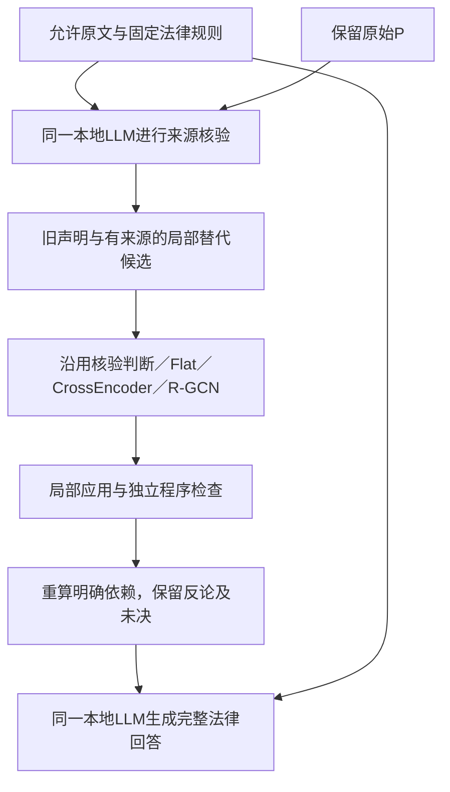

# 来源语义核验与可检查法律推理：研究主线和实施计划

更新：2026-10-12。用户已授权按本方案集中实现、冻结、训练并比较完整回答。**V20共同实现已接通；运行时发现约束前缀死路后，V20.1另存修复、完成缓存验收并恢复固定批次。当前已按用户要求在280457/Q02保存后安全暂停，尚无本轮语义收益结论。** 当前进度见[V20.1报告](../outputs/proof-source-verification-v20/continuation-01/report-zh.md)及[续接冻结协议](../outputs/proof-source-verification-v20/continuation-01/freeze/protocol.json)。[原V20记录](../outputs/proof-source-verification-v20/report-zh.md)、[V19_8报告](../outputs/proof-pipeline-diagnostic-repair-v19-8/report-zh.md)和[原始调查方案](../outputs/source-grounded-verification-design-v1/report-zh.md)保持可追溯版本，不改写为后续结果。

## 研究目标与 motivation

我们要研究的是：在同一个可本地部署的LLM、相同允许来源和法律规则下，怎样将模型提出的分析变成有出处、能检查、能追踪修正的推理链，并验证这条流程是否改善完整法律回答。当前任务是历史判决推理重建，允许阅读法院理由；不能把重建结果称为判前预测，也不能把复述法院结论当作证明其正确。

这一目标与老师的可视化法律论证和proof-carrying推理主线一致。支持、反对和冲突关系由图保存；明确的对象、前提、规则和版本由独立程序检查；自然语言含义及开放法律判断仍需来源核验。图分数不代表法律真值，程序接受也不代替法律批准。

开展下一步的动机来自实际失败。此前确有地址、局部隔离、共享变量和保存接口缺陷，相关修复已恢复部分材料的处理。与此同时，当前原始P中仍有把法官绑定为承租人、颠倒法院处理异议的方向、用有效但不相关的来源支持具体事实等错误。这些记录可以符合JSON和地址合同，却仍然误解来源。Together和本地出现相近错误，说明不能继续主要归咎Mac；两者的量化与服务实现不同，也不足以排除部署因素或证明模型容量是唯一原因。

因此，下一步需要处理的是**来源中的含义如何成为图中的声明，以及声明修正如何传递到完整回答**。继续只优化编号或扩大生成预算，不能直接解决这个问题；直接训练含义混杂的“用途可用”标签，也可能学不到决定性错误。

## 核心 insight 与待验证假设

核心 insight 是：**可检查的推导依赖可核验的语义声明；错误声明被拒绝以后，还必须存在有来源的替代候选，才能恢复正确分析。** 检查器能验证声明之间是否满足明确合同，却不能仅靠合同确认声明忠实于原文。分类器能拒绝“法官是承租人”，但一个拒绝标签不会自动产生正确的承租人。

例如，原文记载“出租人主张租户已经交出占有”。“出租人提出了这个主张”与“租户已经交出占有”应分别保存。前一个声明可以得到来源支持，后一个仍需要其他依据；即使某条证据对后一个声明有支持作用，也不自动证明整个法律前提成立。法院在特定阶段采纳了哪种判断，又是需要另行核验归属和范围的声明。

这意味着必须分清三个障碍：正确材料没有进入候选，是证据发现或提议问题；材料已经在输入中但连接错误，是语义核验问题；连接已经修正而完整回答仍沿用旧结论，是依赖重算或最终使用问题。三者不能用同一个局部分类分数解释。

我们提出三个可被结果否定的假设：

| 假设 | 改进机制 | 必须看到的证据 |
|---|---|---|
| H1：明确声明的来源核验比一般自我复核更能纠正决定性误读 | 用同一允许原文核对对象、归属、用途和完整前提依据，并提出局部替代 | 具体来源错误减少，正确依据及主要反论没有同等严重损失；额外调用成本单列 |
| H2：局部修正只有接入依赖重算和最终材料，才有机会改善完整回答 | 保存版本化修订，重算受影响的前提和规则路径 | 能追踪“声明变化→材料或依赖变化→最终回答变化”；无法追踪的只报告共现 |
| H3：跨证据关系可能给GNN带来超过同信息文本模型的收益 | 在共同候选和证据包上比较Flat、CrossEncoder和R-GCN | GNN改善对象、阶段或反对依据的整合，并传递到完整回答；局部F1提高不足以支持该假设 |

来源核验、纠错和图证据聚合本身已有研究。本项目的拟研究贡献是把它们接入法律推理重建，明确语义声明、程序检查与法律接受的边界，并实测错误修正能否传递到完整回答。目前不声称方法首创或已有有效性证据；[17篇原始研究](../outputs/source-grounded-verification-design-v1/literature.json)提供设计依据和适用限制。

## 准备改进什么

| 当前问题 | 计划中的共同改动 | 保留的边界 |
|---|---|---|
| 地址有效，但对象、说话者或法院阶段错误 | 核验一项含对象、命题、阶段和范围的明确声明 | 来源定位成功不自动批准语义 |
| 只核查P已引用窗口，可能看不到遗漏 | 核验LLM读取完整允许来源及由规则生成的中性问题目录 | 不增加外部RAG，不用参考选择“正确段落” |
| 拒绝错误后，没有正确候选可用 | 允许一次有来源的替代绑定、归属修订或新见证提议 | 原P不可变，不猜改旧地址，不人工补正确答案 |
| 相关证据、合法反对与整个前提成立混用 | 分别保存具体作用、完整前提判断及其依据 | USABLE或SUPPORTED用途不能直接变成前提TRUE |
| 局部修改未传到后续结论 | 重新计算明确依赖，生成统一分析视图 | OPEN_TEXT不改成AND；外部法院判断明确标注 |
| 三模型信息与长度处理不一致 | 共用来源包、关系、监督掩码及可追溯分段 | 不让CrossEncoder静默截断，也不只给GNN额外信息 |

## 完整pipeline与学习组件职责

程序管理合法来源地址、内部编号、版本、原文恢复和明确规则计算。核验LLM负责需要阅读语义的对象对应、陈述归属、具体证据作用及完整前提依据；它一次性提出有来源的局部修订，不反复自我纠错。隐藏P自评标签和自我辩护性结论，但保留待核验声明。使用同一个LLM意味着两次判断可能共享错误，独立会话不构成统计独立。

学习组件统一预测“当前来源是否支持这项具体声明”，输出SUPPORTED、UNSUPPORTED或UNRESOLVED。明确错误才能判UNSUPPORTED；缺少信息与合理争议保留UNRESOLVED；技术失败为null。合法反对证据可以支持“该证据反对命题p”这一声明，不会因此把p设为真。三个模型使用同一候选集，不能创造新对象或规则，也不能读取DEV参考。

核验LLM读取完整允许来源，学习模型则读取共同、确定性装配的声明证据包。必须分别记录全文保存、证据恢复、编码范围和实际模型输入。标签必须依赖包外材料时，该项暂不进入监督；不能利用参考把答案段落偷偷加入输入。支持、反对、依赖和对象候选关系同样提供给三个模型，GNN的独特变量是关系传播方式。

独立程序检查只确认可执行合同。最终结果分别显示结构检查、依赖未验证模型语义的条件性推导、实际来源审阅状态和法律批准状态。原始证据、反论、失败用途及独立替代路线继续保存；不能通过拒绝大量分析获得表面可靠性。

## 实现与实验安排

一次集中实现核验任务包、版本化补充候选、同信息学习输入、预测应用、依赖重算及最终规范视图。复用当前源码和缓存完成真实入口验收，覆盖正确连接保留、错误连接拒绝与局部失败，不逐字段新增模型实验。随后冻结合同、任务、数据、预算和评价，再整批运行；自然语义错误不触发改prompt重跑。

V20固定已有30个TRAIN、10个DEV及原分组，每案一个预定请求及必要依赖，不读取TEST／SEALED。旧P和参考仅在含义、实际输入与配置兼容时复用；旧USABLE标签不能整体改名。此次生成合同改变，旧P仅作回归材料，不混入新本地配置的训练提议。10份兼容DEV评分清单在新回答前保存并固定。TRAIN内按纠纷安排训练验证，DEV参考只用于评价。两份Together输出属于暴露过的开发诊断，不能冒充固定本地配置生成的P或独立测试。

| 阶段 | 具体交付 | 验收依据 |
|---|---|---|
| 共同实现与冻结 | 来源核验合同、候选及输入映射、局部应用、依赖和保存入口 | 真实入口保留合法内容、拒绝错误连接；工程通过不算语义成功 |
| 数据生成与参考固定 | 必要P、一次核验提议、兼容标签及来源评分清单 | TRAIN监督在训练前固定，DEV评分清单在查看答案前固定，无参考进入受测输入 |
| 固定训练与完整运行 | Flat、CrossEncoder、R-GCN各一个种子；A—G完整回答 | 相同候选、来源、关系、接受政策和最终预算；没有效果也正常交付 |
| 集中评价 | 局部纠错、完整回答、错误传播与成本 | 来源核对决定性变化，按纠纷等权，不把连接数量当案件数量 |

七个完整回答条件保持为：A直接回答；B复核自己的A；C读取原P；D读取来源核验及共同处理结果；E、F、G分别在D的相同候选上使用Flat、CrossEncoder、R-GCN判断。D—G属于新方法版本。C与D比较的是新增整套核验机制，包含额外计算；D与E/F/G比较学习判定，F与G等比较同信息下的建模差异。B也不与D严格等成本，不据此单独归因某一组件。

经本次实施授权，资源上限为必要P最多87次、来源核验最多80次、完整回答最多70次，本地最坏237次；生成36小时，P／核验／最终各预留12小时；三模型各一次拟合，训练总上限24小时；网页参考和评分最多70次Extra High。冻结清单实际安排77份P、80份核验和70份最终回答，共227个生成位置；不为花完上限增加任务。重试为零。P连续两次发生同类重复或截断失败时，保存可用分包并停止后续P派发，其他独立步骤按依赖与剩余预算处理。完整分包与实际调用以V20冻结协议和运行记录为准。

共同实现沿用明确的旧规则合同；其余规则保留完整自然语言前提和局部角色地址，不根据同名角色推测跨前提身份。目前各案均存在部分未映射的共享变量合同，相关程序路线保持未决，不能声称检查器已经执行全部法律规则。最终回答仍读取相同完整允许来源和法律文本，并显示这些限制。32项工程检查、真实tokenizer约束回放和旧缓存入口回放验证了所测处理行为，不证明语义提议或完整法律回答正确。

## 如何判断值得继续

局部报告三类混淆、precision／recall、Macro-F1、错误放行、错误拦截及未决去向，同时保留原P、核验提议和训练先验基线。完整回答使用共同冻结清单，报告已确认关键内容正确覆盖、无依据实质判断率、重大错误纠纷比例和整体完成情况；技术null及预定任务完成率单列。评价依据仍是模型生成并经来源审阅的参考，不是人工金标准。

每项可归因变化应连接到具体预测、实际证据使用、依赖和最终回答。共同接口恢复单独报告，不算GNN或CrossEncoder收益。两种方法有不同重大错误时保留取舍，不用临时加权总分宣布赢家。

若D已改善完整回答而学习模型没有额外收益，保留简单核验流程。若Flat或CrossEncoder取得同等收益且成本更低，优先简单模型。只有GNN在同信息下提供额外、可追溯的完整回答收益，才考虑扩大。若正确替代候选始终没有生成，下一步针对来源提议；若局部连接正确但最终答案仍误用，下一步针对最终材料使用。若A同等或更好，允许保留A，不以组件数量作为研究进展。

本文件区分研究假设、已实现接口和尚待评价的收益。V20固定批次现已按用户要求暂停，恢复需要后续授权；历史报告、原始P、标签、权重、失败和冻结记录保持不变，不提交或推送。
