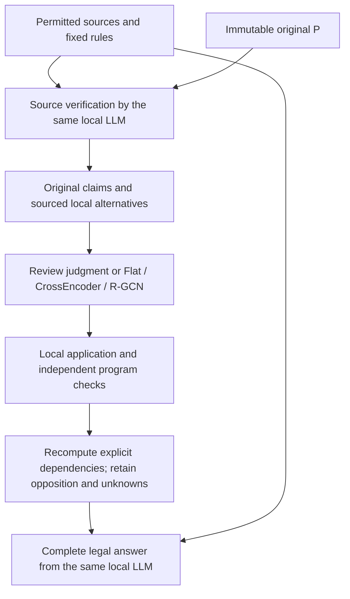

# Source-semantic verification and checkable legal reasoning

Updated October 12, 2026. This records historical authorization for consolidated implementation, freezing, training, and complete-answer comparison; it does not authorize restarting work now. V20 interfaces were connected. After a dead-end constrained prefix, V20.1 separately repaired the issue, passed cache acceptance, and resumed the fixed batch. The batch subsequently paused safely at the user's request after saving 280457/Q02. No semantic-benefit conclusion is established. See the [V20.1 report](../outputs/proof-source-verification-v20/continuation-01/report-zh.md) and [protocol](../outputs/proof-source-verification-v20/continuation-01/freeze/protocol.json). [V20](../outputs/proof-source-verification-v20/report-zh.md), [V19.8](../outputs/proof-pipeline-diagnostic-repair-v19-8/report-zh.md), and the [original investigation](../outputs/source-grounded-verification-design-v1/report-zh.md) remain historical versions, not rewritten later outcomes.

## Goal and motivation

Under one locally deployable LLM, identical permitted sources, and fixed rules, convert proposed analysis into sourced, checkable, revisable reasoning and test whether complete legal answers improve. This is retrospective judgment reconstruction with court reasons available, not pre-decision prediction or proof that a repeated judicial conclusion is correct.

The goal follows the professor's visual argument/proof-carrying direction. Graphs retain support, opposition, and conflict; independent programs check explicit objects, premises, rules, and versions. Natural-language meaning/open legal judgments require source review. Graph scores are not legal truth, and program acceptance is not legal approval.

Observed failures motivate this work. Address, local-isolation, shared-variable, and saving repairs restored some processing, but raw P still binds judges as tenants, reverses courts' treatment of objections, or cites valid yet irrelevant passages. JSON/address validity does not ensure faithful reading. Similar Together/local errors make blaming the Mac alone untenable, but different quantization/service implementations prevent ruling out deployment factors or identifying model capacity as the sole cause.

The focus is how source meaning becomes graph claims and how corrected claims propagate to complete answers. More IDs/output budget do not directly solve that problem. Training semantically mixed “usable evidence” labels may miss decisive errors.

## Insight and falsifiable hypotheses

Checkable derivation requires reviewable semantic claims. Rejecting a wrong claim also requires sourced alternatives to restore correct analysis: rejecting “the judge is the tenant” does not identify the actual tenant. Contracts check relations between claims, not their fidelity to sources.

For example, “the landlord asserted that the tenant surrendered possession” supports a record of that assertion. The actual surrender remains a different proposition requiring support. Evidence contributing to it does not establish the whole legal premise. Whether a particular court adopted it at a particular stage requires separate attribution/scope review.

Distinguish missing correct candidates (discovery/proposal), wrong links despite available material (semantic verification), and continued use of old conclusions after correct links (dependency/final-use failure). One local classification score cannot explain all three.

| Hypothesis | Mechanism | Required evidence |
|---|---|---|
| H1: explicit source-claim verification corrects decisive misreadings better than generic self-review | Check objects, attribution, uses, whole-premise bases against the same sources; propose local alternatives | Fewer concrete errors without equally serious loss of correct grounds/counterarguments; extra cost reported |
| H2: local corrections can improve final answers only when dependencies/final material are updated | Version revisions and recompute affected premises/routes | Trace claim → material/dependency → final-answer change; otherwise report co-occurrence only |
| H3: cross-evidence relations may benefit GNNs beyond same-information text models | Compare Flat, CrossEncoder, R-GCN on shared candidates/packages | Better object/stage/opposition integration reaching complete answers; F1 alone is insufficient |

Source verification, correction, and graph evidence aggregation have prior work. The proposed contribution connects them to legal reconstruction with explicit semantic/program/legal-acceptance boundaries and tests propagation to final answers. Neither originality nor effectiveness is established. [Seventeen original studies](../outputs/source-grounded-verification-design-v1/literature.json) supply design evidence/limitations.

## Planned shared changes

| Problem | Change | Boundary |
|---|---|---|
| Valid addresses, wrong objects/speakers/stages | Review explicit object/proposition/stage/scope claims | Location does not approve meaning |
| Reviewing only P citations misses omissions | Full-source review with neutral rule-derived questions | No external RAG or reference-guided correct-passage selection |
| Rejection leaves no alternative | One sourced replacement binding/attribution/witness proposal | Immutable P; no guessed addresses or manually correct answers |
| Relevance/opposition confused with whole-premise truth | Separate evidence role, whole-premise judgment, and basis | USABLE/SUPPORTED use does not imply TRUE |
| Local edits fail to reach conclusions | Recompute explicit dependencies into a shared analysis view | OPEN_TEXT remains open; external court judgments attributed |
| Unequal model information/length handling | Shared packages, relations, masks, traceable chunks | No silent CrossEncoder truncation or GNN-only extra information |

## Pipeline and learned components

Programs manage source addresses, internal IDs, versions, source recovery, and explicit rule operations. The verifier assesses objects, attribution, evidence roles, and whole-premise bases, proposing sourced local revisions once rather than iterating to success. Hide P self-labels/self-defense while retaining claims. The same LLM can share errors across calls; separate conversations are not statistical independence.

Learners predict support for a specific claim: SUPPORTED, UNSUPPORTED, UNRESOLVED. Only explicit errors warrant UNSUPPORTED; missing information/reasonable disputes remain UNRESOLVED, technical failures null. Opposition can support the claim “this evidence opposes p” without making p true. All models share candidates and cannot create objects/rules or read DEV references.

The verifier reads full permitted sources; learners read a common deterministically assembled evidence package. Record stored text, recovered evidence, encoding coverage, and actual inputs separately. Labels requiring outside-package material are temporarily excluded from supervision; references cannot secretly add answer passages. All three learners receive support/opposition/dependency/object-candidate relations. The GNN-specific variable is propagation.

Checks establish executable contracts only. Results separate structural checks, conditional derivation depending on unverified model semantics, source review, and legal approval. Original evidence, counterarguments, failed uses, and independent alternatives remain; rejecting most analysis cannot masquerade as reliability.

## Implementation and experiments

Implement verification tasks, versioned alternatives, shared learner input, prediction application, dependency recomputation, and final views in one integration. Reuse source/caches for actual-entry acceptance of correct retention, wrong-link rejection, and local failure, without field-by-field model experiments. Freeze contracts/tasks/data/budgets/evaluation, then run the batch. Natural semantic errors do not trigger prompt tuning/reruns.

V20 retains 30 TRAIN/10 DEV and original groups, one predetermined request/dependencies per case, no TEST/SEALED access. Old P/references are reusable only with compatible semantics/input/configuration; USABLE labels cannot simply be renamed. Because generation contracts changed, old P is regression material, not new local-configuration training proposals. Ten compatible DEV checklists freeze before new answers. TRAIN-internal validation groups follow disputes; DEV references are evaluation-only. Two exposed Together diagnostic outputs are neither locally generated P nor independent tests.

| Stage | Deliverable | Acceptance |
|---|---|---|
| Shared implementation/freeze | Verification contracts, candidate/input maps, local application, dependencies/saving | Real entries preserve valid content/reject wrong links; engineering is not semantics |
| Generation/reference freeze | Required P, one review proposal, compatible labels/source checklists | TRAIN supervision before training; DEV checklist before answers; no reference input leakage |
| Fixed training/full execution | One seed each for Flat/CrossEncoder/R-GCN; A–G answers | Shared candidates/sources/relations/policy/final budgets; negative results retained |
| Consolidated evaluation | Local corrections, final answers, error propagation/cost | Source-supported decisive changes; equal dispute weight, not link counts as case counts |

Historical conditions: A direct; B self-reviews A; C original P; D source review/common processing; E/F/G use Flat/CrossEncoder/R-GCN on D's candidates. D–G are new-method versions. C/D compares the whole added verification mechanism and extra computation. D versus E/F/G compares learned judgments; F/G compares same-information modeling. B/D are not strictly equal-cost. These historical conditions do not supersede the user's later one-call minimal-baseline requirement.

Historical authorization caps: at most 87 P calls, 80 review calls, 70 final calls (237 local maximum); 36 generation hours split 12/12/12; one fit per model and 24 training hours; at most 70 Extra High reference/scoring calls. The freeze actually schedules 77 P + 80 review + 70 final = 227 positions, not extra tasks to consume limits. Zero retries. Two consecutive same-kind P repetition/truncation failures save usable partitions and stop further P; independent steps follow dependencies/remaining budget. Actual partitions/calls are defined by frozen protocol/run records.

Existing explicit rule contracts are reused. Other rules keep full natural-language premises/local role addresses without guessed cross-premise identity. Every case has some unmapped shared-variable contracts; affected routes stay unresolved rather than claiming full legal execution. Final answers still see identical full sources/legal text and disclose limits. The 32 engineering checks, real-tokenizer replay, and old-cache replay validate tested processing, not semantic/legal correctness.

## Continue, change, or stop

Local reporting includes three-class confusion, precision/recall, Macro-F1, false acceptance/rejection, unresolved destinations, original P, review proposals, and TRAIN priors. Complete answers use the frozen checklist for verified critical-content coverage, unsupported substantive judgments, dispute-level major errors, and overall completion. Technical nulls/planned-task completion are separate. References are source-reviewed model outputs, not human gold.

Attribute changes only through specific predictions, actual evidence use, dependencies, and final answers. Interface recovery is not GNN/CrossEncoder benefit. Preserve differing major-error tradeoffs rather than inventing weighted winner scores.

If D improves final answers and learners add nothing, retain simple verification. Prefer Flat/CrossEncoder when they match benefits at lower cost. Expand GNNs only with additional traceable complete-answer gains under equal information. Missing correct alternatives redirects work to source proposals; correct links misused in answers redirects it to final use. A may be retained if equal or better; module count is not progress.

This plan distinguishes hypotheses, implemented interfaces, and unmeasured benefits. The fixed V20 batch remains paused by user instruction and needs later authorization to resume. Historical reports, original P, labels, weights, failures, and freezes remain; no commit/push.
