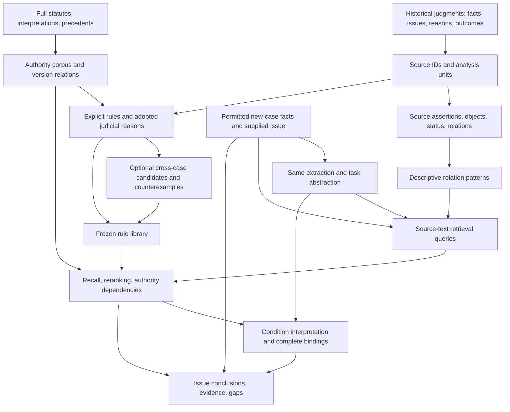

# From cases and issues to rules, legal retrieval, and request assessment: V1 design

Date: October 1, 2026. Status: **complete design; foundational components partly implemented; two-case checks failed; no complete legal experiment.** See the [stage report](../../../outputs/rules-verdict-v1/report-zh.txt). This proposal combines current code with [R2 design review](../../reviews/2026-10-01-pro-rgcn-v1-review.md). Sequence, budgets, and acceptance are in the [implementation plan](IMPLEMENTATION_PLAN.md). Component names include planned interfaces; actual implementation is established by code README/stage reports.

The goal is to extract sourced reusable rules from historical cases/legal authorities, help new cases find applicable law, and produce grounded request-by-request/issue-by-issue conclusions. Fact-relation experiments are intermediate diagnostics. Whether a benchmark becomes the primary contribution depends on later evidence.

## 1. V1 choices

Use a fixed LLM for extraction/interpretation, hybrid text retrieval, explicit condition binding, and bounded rule composition. The historical first comparison is ordinary text-retrieval-augmented answering. Do not initially train a GNN, expand to 100 cases, or relabel the old 20. This historical comparator design does not override the user's later requirement that an ordinary baseline be one direct LLM call unless additional mechanisms are explicitly approved.

| Component | V1 choice | When an alternative becomes justified |
|---|---|---|
| Generation/extraction/rule proposals | Existing Qwen3.5-9B-4bit, MLX-VLM, JSON Schema constraints | After the first round, replicate key comparisons with another model to test 9B specificity |
| Sources/records | Python standard library, JSONL, SQLite; immutable text/stable locations | No initial graph database/distributed system |
| Fact categories/families | Versioned definition cards, conservative assertion-to-task mapping | Supervised contrastive learning only with enough labels and recurring category confusion |
| Relation patterns | Existing typed two-event candidate search with bindings, generated on development data | No arbitrary-length pattern search initially; rare exceptions remain in rule paths |
| Explicit rules | Extract RuleCards from complete provisions/reasons, then separately review sources | Single-case explicit rules need no cross-case support, but retain distinct legal status |
| Cross-case induction | Compatible groups, at most three candidates, hard-neighbor checks, one sourced revision | If insufficient material, stop at explicit-rule extraction |
| Authority recall | SQLite FTS5/BM25 + Qwen3-Embedding-0.6B, RRF | BM25 control first; graphs only with a justified same-information experiment |
| Reranking | Qwen3-Reranker-0.6B, separate relevance/scope status | Frozen GFM-RAG later; LawRanker only with sufficient supervision |
| Condition application | Typed relational queries, shared bindings, AND/OR, explicit negation, required date/number comparisons | Unsupported legal expressions remain unsupported; never delete conditions to fit code |
| Request conclusions | Execution table + originals + authorities into the same 9B; mechanical traces retained | Separate VerdictNet study after stable request labels |
| Source review/references | Ordinary High website model with actual settings/source review | Not human gold; never use it to correct tested model facts |

The 0.6B retrieval models are pretrained encoders/rerankers, not another legal decision generator. Use a separate fixed-revision/dependency retrieval environment and sequential loading with 9B to avoid simultaneous unified-memory use. Local adaptation/resource checks are not complete; planned configuration is not verified performance.

## 2. Two data flows

Historical reasons/outcomes may inform rule construction. New-case methods see only permitted facts, requests, issues, and procedure, not predicted outcomes, decisive target reasons, or answer-revealing authority labels. New cases do not update the shared rule library during execution.

An analysis unit is `case + request/defense + issue + current stage`. V1 receives the issue as input; automatic issue discovery is separate future work. Rent claims, subletting eviction, and appellate reversal are separate requests, never one WIN/LOSE. Source-document stage, event time, and current assessment stage are distinct. Earlier facts may inform current issues; reversed earlier findings are not automatically currently accepted facts.

## 3. Shared data objects

| Object | Fields and use |
|---|---|
| SourceDocument | Document ID, raw hash, URL/page, full passage IDs, version/date/jurisdiction; read-only text |
| CaseTask | Case/dispute group, claimant/respondent, request, issue, stage, temporal basis, permitted sources, target result type |
| SourceAssertion | Location, speaker, asserted action/state, polarity, court treatment, source stage; assertions do not become events by quotation alone |
| Entity / Event | Local identity/type/role, participants, time, attributes; identity differs from role and matching names are insufficient |
| UnresolvedItem | Reason, location, affected field paths, possible whole-proposition impact; unknown does not erase reliable fields |
| TaskAbstraction | Assertion, definition-card ID, retained/generalized fields, unexpressed content, task/version; does not overwrite assertions |
| Relation | Directed endpoints/type, support/opposition/uncertainty, source/status; absent edges are not false relations |
| PatternCard | Meaning, executable query, shared variables, generation method, development support, unknowns/failures, witnesses; descriptive status |
| AuthorityUnit | Statute subsection/reasoning unit, full context, effective version, citation/definition/exception relations, source/status uncertainty |
| RuleCard | Source nature/scope, typed variables, conditions, necessity/sufficiency/factor status, effects, exceptions, burdens, quotes, formalization coverage |
| ApplicationTrace | Relevance, scope compatibility, bindings/condition evidence, gaps/conflicts, executable/model-assessed portions, exclusions |
| DecisionRecord | Per-request outcome, support/counterevidence, unresolved issues, prediction versus derivation, execution and version hashes |

RuleCard source types are EXPLICIT_STATUTE, EXPLICIT_JUDICIAL, CROSS_CASE_HYPOTHESIS. PatternCards remain separate. Legal authority, actual judicial adoption, and model review are independent fields. Model agreement cannot confer legal force on an inductive hypothesis.

Execution and answers are separate. `run_status`: OK, INPUT_TOO_LONG, OUTPUT_TRUNCATED, FORMAT_ERROR, TIMEOUT, OUT_OF_MEMORY, UNSUPPORTED; failures have null answers. Local unsupported components/conditions are not source missingness. Relational results remain MATCH, NOT_FOUND, UNKNOWN. Legal outcomes use explicit request/procedure labels and `assessment_status` for supported, unresolved, disputed, or unsupported language; MATCH does not mean a claimant wins.

## 4. Offline preparation

### 4.1 Sources, time, and input isolation

Reuse complete existing sources/fixed candidate order and build a task manifest rather than rescreening the whole corpus. Record exact duplicates, known shared disputes, and unconfirmed relationships. Known litigation chains stay grouped and cannot be new-dispute tests. Report uncertain relationships separately.

Development judgments retain full text. New cases receive separate views excluding target reasons/outcomes and direct label leakage, including derived summaries, filename metadata, and embedding text. Difficult separation retains risk flags, not a claim of perfect isolation. Facts curated within a final judgment support “legal application/retrospective assessment given facts,” not recreation of actual pre-decision evidence acquisition.

Start a corpus around one legal regime actually used in development: full statutory versions, definitions/exceptions, cited precedents, and adjacent provisions. It cannot contain only provisions in new-case reference answers. Sources added after seeing a new answer cannot enter the same primary comparison.

Distinguish versions needed at event time, filing time, and assessment time; judgment date alone does not select latest law. Unknown scope/version retains candidates with uncertainty, without assumed retroactivity. This is source management/conditional experimentation, not a comprehensive update of Indian law.

### 4.2 Extraction before category mapping

Use 9B/schema constraints over all permitted text in original order. Initial chunks: at most 4,000 model tokens, 400-token overlap; do not split numbered sentences. Oversized sentences stand alone; budget violations fail explicitly. Chunk model input without deleting sources. One output per chunk, then at most one cross-chunk identity/relation consolidation per case; no repeated type-specific fact fishing.

Each extraction retains passage, local subject/object mention IDs, original action, candidate category, speaker/treatment, negation, qualifiers, and affected fields. OTHER/UNKNOWN prevent forced mapping of, for example, own-use need into actual subletting. Competing types retain original description/dispute rather than forced enum selection.

Extend object types only as selected rules require: PERSON/ORG/GROUP/PROPERTY plus explicit LEASE/CONTRACT or NOTICE where needed. Types preserve identity, not automatically new legal relations. New types/slots require source examples and development freeze. Amounts retain value/currency/period; time retains wording/parsable range, with unknown for failed normalization.

Automatically deduplicate only same-location, same-meaning records. Names, roles, and similarity propose identity candidates only. Consolidation receives mentions/relevant text and proposes sourced same-entity/directed-relation/unresolved decisions. No automatic name merge. Unlinked records retain separate identities; alias, identity, and membership are different relations.

Return stable passage IDs/optional offsets; converters copy original text rather than requiring the model to rewrite long quotations. Validate IDs, object references, types, completeness; retain generation/raw/conversion logs. A located quote may still fail to support the extracted fact; evaluate that semantic error rather than treating format validity as truth.

Coarse type differs from proposition establishment. Unknown arrears duration does not send reliable payment records into subletting candidates; polarity, amount, date, or contract attribution may still be unusable. Whole-sentence/unclear qualifier effects retain whole-sentence blocking. Do not remove `*` automatically or guess qualifier meaning from keywords.

### 4.3 Normalization, clusters, and families

Create a few issue-relevant definition cards describing meaning, required roles, retained distinctions, permitted generalization, and boundary examples. “Payment” may be a family; “full rent payment under the specified lease” is narrower. Arrears, partial payment, and claimed payment cannot collapse into one positive fact through lexical similarity.

First retain faithful assertions, then map to cards. Names/aliases retrieve candidates; larger catalogs may use the 0.6B encoder. The LLM evaluates the entire definition with sourced reasons. No match yields an unclassified candidate, not a rewritten definition. Review unclassified items together in development; frozen new cases cannot create global categories.

A cluster groups expressions matching one definition; a family groups related definitions. Every record retains case-local objects, quantities, times, status, and provenance. Retrieval may use broad families; legal conditions require representations retaining necessary distinctions. Task abstraction is not universal legal equivalence.

Whole-corpus clustering is unnecessary initially. Contrastive learning, DBSCAN, or LLM batch merging requires independent same/different references and evidence that mapping is a bottleneck. Vector distance does not decide legal equivalence.

### 4.4 Descriptive patterns

Enumerate two events in development facts, generalize names, retain shared objects and supported part_of/member_of direction. Deduplicate canonical query strings; cap candidates at 1,000. Recurrence requires at least two development analysis units in different cases; multiple witnesses in one case do not multiply support. Also report dispute-group support and uncertain relationships; two docket IDs need not be independent disputes.

Definition cards govern statement status/unknown dependencies; only usable fields enter corresponding uses. Save candidates, executions, witnesses, and truncation points. Add no temporal condition without a time source; unknown is not certain mismatch. Patterns support retrieval/comparison/rule-material proposals, not statutory content or outcomes.

Two-event search does not limit legal rule conditions. A five-condition rule needs all five or explicit unsupported status, never reduction to two. The old three relation tasks remain diagnostics, not three legal elements.

### 4.5 Explicit rules

For each historical analysis unit, collect issue, factual basis, adopted proposition, original reasons, authorities, stage, and outcome. Distinguish third-party views, party assertions, rejected interpretations, and adopted interpretations. Save natural-language RuleCards before compiling executable parts.

Cards identify governed persons/objects/relations, jointly required conditions, necessity/sufficiency/factor/exception roles, burdens/counterproof/procedural limits, and supporting passages. No compiler-created biconditional unless sources establish it.

One ordinary High development review compares full sources/cards and retains disagreements. Unreviewed cards can guide retrieval but cannot enter deterministic legal derivation. Natural-language interpretation must correspond condition-by-condition to code. Types, executability, and model agreement do not prove legal interpretation.

### 4.6 Optional cross-case induction

Group by issue, jurisdiction, legal version, stage, and interpretive scope. Where compatible material supports induction, 9B proposes at most three cards per group from rule-material packages/patterns. Identify the new generalization, whether already explicit in a judgment, and remaining hypothetical conditions.

Check at most six compatible neighbors per candidate, prioritizing similar facts/different outcomes and same outcomes/different reasons. Absence of a condition in text does not refute necessity; establish its actual absence or inability to play the claimed role. Outcomes: support, genuine counterexample, incompatible scope, insufficient information.

Permit one sourced revision per candidate: add a documented omitted condition, limit scope, add a supported exception, or correct binding. Wrong prediction alone does not justify changing legal meaning. Retain all candidates/failures; freeze with HYPOTHESIS status.

This borrows proposal/verification/update from [SILVER/LRI](https://arxiv.org/html/2505.14104v2) and hard-case selection from [RLJP](https://arxiv.org/html/2505.21281v1). Acceptance depends on sources/scope; majority support or prediction scores do not establish legal validity. These links are historical design references, not new verification in this documentation edit.

## 5. New-case processing

### 5.1 Source and structured queries

Use identical extraction. Query one includes supplied issue/request/stage/original facts; query two includes sourced types, roles, object relations, and matched patterns. Neither may contain reference answers, target citations, or guessed winner labels.

Each query uses BM25 and vector recall, at most 50 per channel/200 before merging. [Qwen3-Embedding-0.6B](https://huggingface.co/Qwen/Qwen3-Embedding-0.6B) uses 1,024 normalized dimensions/cosine similarity with a relevant-conditions/precedents instruction. Small corpora use direct matrix retrieval, no vector database.

RRF sums `1/(60+rank)` across channels, breaking ties by stable authority ID. Retain channel ranks to separate text, structure, and additional-retrieval effects. Preserve old law versions. Explicitly incompatible scope may exclude; unknown scope remains flagged.

### 5.2 Reranking and context completion

Rerank top 40 RRF units with [Qwen3-Reranker-0.6B](https://huggingface.co/Qwen/Qwen3-Reranker-0.6B), asking whether each helps assess the issue, including supporting/opposing law. Initially choose eight units, then follow explicit definition/exception/amendment/citation dependencies for at most two rounds/24 total units. These are development starting values to freeze after resource/coverage checks, not demonstrated optimal values.

Index complete provisions/reasoning paragraphs; long units have parent-linked retrieval fragments. A fragment hit restores its full parent and required dependencies. Never silently truncate provisos/exceptions. Budget overflow records uncovered material; deterministic derivation cannot use cards lacking necessary context.

Save relevance, scope compatibility, and condition evidence separately. An unsatisfied payment condition does not make payment/eviction law irrelevant: it may support rejection. Only incompatible rule scope, such as jurisdiction, warrants sourced scope exclusion.

### 5.3 Binding conditions to facts

Development compiles selected RuleCard conditions to definition-card/field mappings; new cases use frozen mappings. Unmapped explicit authority may receive textual interpretation marked LLM judgment, not newly invented predicates presented as verified code.

Conditions declare fact type, participants, contract/property identity, relation direction, status, negation, and required time/amount. Exclude reliably incompatible types first, then inspect other dependencies. Unknown dates block date comparisons only; unknown status still blocks promotion to accepted positive findings.

Index by type/usable status and obtain binding tables per condition. AND joins shared variables; OR retains branches/provenance. Do not collapse rows to booleans before joining. Order execution by candidate count then condition ID to reduce Cartesian products. Unknown values do not equal arbitrary concrete values. Initially allow 10,000 partial-binding expansions per rule/case, saving counts/stop positions; do not beam-prune low model scores. Same type is not same identity; identity is not group membership; absent part_of is not proven disconnection. No default transitive closure.

### 5.4 Execution and legal composition

The restricted language includes typed atoms, local existential quantifiers, AND/OR, explicit sourced negative facts, object equality/difference, existing directed relations, and date/number comparisons needed by selected rules. Amount comparisons use Decimal/currency; date precision follows sources. Aggregated amounts, payment allocation, unlimited recursion, undefined quantifiers, and open balancing are not mechanically executed.

Per-binding evidence states are SUPPORTED, REFUTED, CONFLICTED, UNRESOLVED, retaining both sides. REFUTED requires compatible opposing evidence, not an empty query. Conflict does not entail every conclusion. Incompatible hypothetical branches/statuses or reversed findings cannot compose one support chain.

Atoms/AND/OR first produce bindings/witnesses, then existential results. At least one complete unblocked witness allows MATCH with other conflicts disclosed. No complete witness but a material unresolved combination yields UNKNOWN. NOT_FOUND requires no witness or material unresolved combination in the defined scope. Exhausted enumeration returns local UNSUPPORTED/incomplete coverage, never NOT_FOUND.

RuleCards specify legal consequences: satisfying necessity alone does not grant relief; supporting factors are not sufficient conditions; exception/default handling needs authority. Failure of proof differs from nonexistence; only explicit burden/proof rules connect insufficient proof to legal effects.

The old executor supports one to four atoms and existing pattern search mainly two events. A new composition layer joins binding tables, not separate boolean queries evading the old limit. Retain every legal condition, including unimplemented portions in cards/results.

### 5.5 Request conclusions and bounded follow-up

Each analysis unit produces an application table of law, scope, complete bindings, supported/opposed/unknown conditions, exceptions, burdens, derivable effects, and unformalized issues. The same 9B reads it, permitted facts, and selected original authorities to produce request/procedural results, evidence chains, counterarguments, and gaps.

Distinguish failed substantive elements, unsupported relief at this stage, reversal/remand, partial support, and insufficient material; labels follow development tasks. Models may predict; programs separately check citations/bindings/deterministic support. Unsupported predictions remain model judgments/conflicts, never repaired facts.

The primary first comparison disables follow-up. Later add one separate experiment: at most one round/two specific gaps per case within permitted sources/frozen law, never target-answer sections or open web. New evidence becomes new records and recomputes affected bindings only. Missing evidence remains a gap; no new global rule. Report additional calls/budget.

This references [LegalGraphRAG](https://arxiv.org/html/2605.28120v1)'s condition checking/supplementary retrieval, while retaining relevant law that may defeat a request rather than pruning every unsatisfied condition's authority.

## 6. Fictional binding example

This illustrates software logic, not Indian law. Assume a reviewed rule requires arrears and service of notice under the same lease, among other necessary conditions.

| Passage | Assertion | Representation |
|---|---|---|
| p1: tenant T owes arrears under K1 | Arrears concern T/K1 | `Arrears(T,K1)`, separate polarity/source status |
| p2: notice concerning K2 was served on T | Notice concerns T/K2 | `NoticeServed(N1,T,K2)` |
| p3: notice N2 is mentioned without a lease | N2 attribution unknown | `NoticeServed(N2,T,?)`, unknown `lease_id` only |

Co-occurrence proposes a candidate because arrears/notice appear together. The relational executor rejects T/K1/N1 because K1 differs from K2. N2's unknown lease makes the existential issue UNKNOWN. N1's failure does not establish that the case has no valid notice; mention of a notice does not satisfy K1's condition.

Without N2 or other candidates in defined scope, NOT_FOUND means no complete witness. Even if later evidence binds N2 to K1, only these two conditions are met; other required conditions/exceptions remain. Binding may reduce wrong joins, not prove extraction, interpretation, or prediction correct.

## 7. Roles of later graph and induction research

Frozen [GFM-RAG](https://arxiv.org/html/2502.01113v3) is a possible graph-retrieval transfer control, after official checkpoint/local adaptation checks. Converting “a party asserts P” into unconditional P loses status; assertions need their own nodes linked to source/status. Retrieval ranking cannot replace condition execution; general-QA transfer does not establish legal benefit.

Train LawRanker only with sufficient authority labels: issue, facts/patterns, conditions, authorities as typed nodes/edges. Compare same-feature linear/MLP before R-GCN. Labels distinguish decisive, relevant, explicitly irrelevant, unjudged; unjudged is not negative. Law defeating a request can remain highly relevant.

Evaluate VerdictNet separately. Inputs contain permitted facts, retrieved authorities, application states, never target outcomes/answer-built graphs. Grouped cross-fitting supplies upstream predictions, avoiding train-time truth replacing test-time prediction. Compare same-information serialized LLM/MLP before graph propagation. Two networks need not arrive together or share architecture.

R-GCN propagation does not automatically execute AND/OR; multiple patterns from one fact are not independent evidence. An issue-conditioned gate per relation type is not independent weighting of every edge. One issue cannot demonstrate cross-issue selection.

These are testable later designs, not V1 prerequisites. First test whether sourced rules, complete bindings, and field-local unknowns improve retrieval/request assessment under shared material/model. Structured overhead may exceed benefit.

## 8. Existing code and gaps

| File | Reuse | Gap |
|---|---|---|
| `legal_bench/field_pipeline_v2.py` | Known fields, qualifier scope, type-first filtering, candidate reasons | New multi-condition bindings/legal effects |
| `legal_bench/typed_relations.py` | part_of/member_of, direction, identity distinctions, source restrictions | No arbitrary legal relations/default closure |
| `legal_bench/mlx_json_constraint.py` | MLX schema syntax constraints | No fact/rule semantic review |
| `legal_bench/compact_output_v3.py` | Passage-ID evidence, conversion, unknown fields | Fixed types/caps/no-time design cannot serve new legal tasks unchanged |
| `legal_bench/split_assembly_v1.py` | Output merging, ID/count checks | New-format adapter; no guessed cross-chunk identity |
| `legal_bench/scoped_mining.py`, `legal_bench/typed_relations.py` | Two-event search/budgets and typed-edge candidates via separate adapters | Not a ready general miner; explicit status adaptation; support count is not legal force |
| `scripts/local_qwen_worker_v3.py` | Fixed model, token/memory/time/failure records | New parameterized entry; preserve old fixed-path/task worker |
| `scripts/repository_bridge.py` | Versions, review volumes, hashes, public allowlist | No automatic website-chat sync; local prepare is not publication |

Place new components in an independent namespace, preserving historical methods/results. See the [implementation plan](IMPLEMENTATION_PLAN.md) for milestones and proposed changes.
