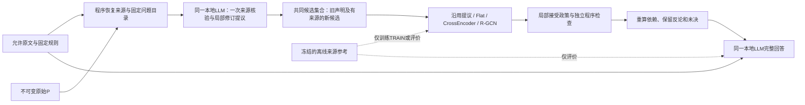

# 从来源核验到完整法律回答：机制调查与实施方案

日期：2026-10-11（America/Phoenix）。状态：**研究与设计提案，尚未实现或运行**。当前已完成实验仍为V19_8；本文件不解除既有生成／训练暂停，不授予新的API费用或网页调用预算。

本次核对了V19_8实际入口及V14—V16相关结果，并检索了来源归因、证据核验、自我纠错、法律文本推断、图证据聚合和过程评价研究。建议保留现有程序检查，增加一个**根据允许原文核验并提出局部修订的语义步骤**。学习目标应从含义混杂的“证据是否可用”，转为“这项明确的对象、归属或前提依据声明是否得到来源支持”。这个机制值得检验，但文献没有证明它能在本项目9B配置上提高完整法律回答。

研究动机、核心insight、拟贡献与实施交付集中见[项目主方案](../../docs/SOURCE_GROUNDED_VERIFICATION_PLAN.md)。本报告保存支撑该方案的文献比较、接口细节、预算和评价合同。

## 1. 研究问题与目前的证据

本方案回答三个问题：第一，如何核验来源究竟说明了什么，而不只核对地址和类型；第二，学习模型在其中承担什么不能由简单程序完成的职责；第三，如何证明局部纠错进入了完整回答，同时没有靠删掉难点获得表面改善。

任务继续是**历史判决推理重建**。完整判决可以说明法院采用或拒绝了哪个判断；重建成功不等于程序独立证明法院法律解释正确，也不等于预测未决案件。分析单位仍是纠纷／阶段、固定请求、具体对象与依赖链。同案多条连接不是多个独立案件。

当前证据必须分开解释：

| 观察 | 可以支持的判断 | 尚不能支持的判断 |
|---|---|---|
| V19_8的47项相关检查通过，恢复8条未决路线；两案前提状态不变 | 已定位的一批接口阻止和漏检得到修复 | 整套代码绝无缺陷，或法律分析已经可靠 |
| District Judge被绑定为tenant；两个LEGAL_CONCEPT角色交换；有效地址引用了不适合当前用途的段落 | 当前自然错误包含来源语义、角色和方向问题 | 所有错误均由模型容量造成 |
| 学习输入恢复P已引内容及固定邻近单元，明确不覆盖全文遗漏检测 | 只复核这批输入不能稳定发现P漏引的决定性材料 | 材料在磁盘上等于模型已经核读 |
| V15自动对齐曾恢复两条限定路径，V16六个新增根规则均OPEN_TEXT | 来源对齐有可复用实现；用途标签无法替代开放法律解释 | 再训练同义未明的标签就能完成所有推导 |
| Together与本地曾出现相近类型的自然错误 | 不能继续主要归咎Mac硬件 | FP8服务与本地4bit构成严格同模型实现对照 |

因此，较可信的解释是：P把来源理解、角色绑定、证据作用和整个前提判断集中生成，部分错误在语义连接处发生；现有检查只能验证这些声明是否满足机械合同。长上下文和任务负担可能加重问题，但本项目尚未做能区分这些原因的因果实验。解码设置与量化也是未排除因素。本轮不同时改它们，否则无法解释机制收益。[当前报告](../proof-pipeline-diagnostic-repair-v19-8/report-zh.md)

## 2. 文献支持什么，又限制什么

本次采用四个检索视角：来源归因与修订、反对自我纠错的证据、法律文本与图推断、局部及完整回答评价。纳入17篇与设计直接相关的原始研究，核对出版页、摘要，并针对关键方法与限制核读正文；没有依赖博客中的效果数字。检索不是穷尽性系统综述，主要研究发表于2018—2025年。没有一篇直接验证“当前Qwen3.5-9B＋本项目判决和规则”的方案；下面从论文到项目的映射均为设计推断。

### 2.1 有来源的核验与一般自我纠错不同

[RARR](https://aclanthology.org/2023.acl-long.910/)和[Chain-of-Verification](https://aclanthology.org/2024.findings-acl.212/)都把生成与复核拆开，但前者重新寻找外部证据，后者的factored版本让核验回答看不到原答案，原实验仍主要依赖模型内部知识。可以借鉴前者的证据回查和后者的输入隔离，不能把“另开一次会话”写成语义独立。

[Huang等的自我纠错研究](https://arxiv.org/abs/2310.01798)发现，无外部反馈的纠错收益会受到额外信息、额外计算和告知答案对错的实验设置影响；[ProCo](https://aclanthology.org/2024.emnlp-main.714/)则提供了具体条件核验可能有效的正面证据。两者并不构成简单矛盾：检查任务、信息和答案形式不同。ProCo主要面对短问题及实体／数字答案，不能直接保证长判决中的阶段归属正确。

本项目应采用“给出同一允许来源、检查明确声明”的流程，保留同模型直接回答和自我复核基线。核验模型不得获得DEV参考或主session修好的连接。RARR还明确承认，局部事实修正可能不修正受其影响的后续推理；因此本项目必须重算依赖，不能只润色P。

### 2.2 引文相关、命题支持和法律充分性需要分别判断

[AIS](https://aclanthology.org/2023.cl-4.2/)先要求输出在语境和时间下含义明确，再判断给定来源是否支持这个含义；[ContractNLI](https://aclanthology.org/2021.findings-emnlp.164/)把文档对命题的蕴含／矛盾／未提及与证据跨度识别分别标注。[FEVER](https://aclanthology.org/N18-1074/)也同时要求判断与证据集。共同启示是：地址正确或句子相关，都不足以确认整个命题。

这对应现有的实际错误：“当事人提出异议”与“异议在法律上成立”是两个命题；“法院允许继续审理”与“法院认定实体权利成立”也不同。反对某个命题的真实记录可以被正确引用，不能因为方向不利而标成无效证据。

这些研究不能替我们批准法律上的充分性。尤其在OPEN_TEXT规则中，若原文只是记载法院采用了一项开放评价，系统最多核验“法院在该阶段采用了该判断”这一重建事实；不能把它转换成程序已独立推导该判断。

### 2.3 图可能帮助多证据整合，但不自带正确语义

[GEAR](https://aclanthology.org/P19-1085/)研究证据图之间的信息传播，[DocInfer](https://aclanthology.org/2022.emnlp-main.51/)研究长文档中的关系、分散证据与文档级推断；它们给出“跨证据信息可能有用”的任务证据。[过程奖励模型研究](https://aclanthology.org/2025.findings-acl.547/)同时说明，监督及评价不当会让验证器学到最终结果捷径，而非步骤正确性。

因此，GNN在这里应检验共同对象、同一安排、支持／反对和规则依赖是否帮助验证某项声明。图边来自原文结构、显式程序关系或模型提议，并分别标记；不能由参考标签生成“正确支持边”。CrossEncoder必须得到相同的相关证据与关系信息，否则“图获益”可能只是信息更多。也不能把GEAR的全连接边、DocInfer的强化学习选句或数学PRM直接移植成新的大架构。

### 2.4 评价必须防止“少说、全拒绝、抄标签”

[FActScore](https://aclanthology.org/2023.emnlp-main.741/)和[SAFE](https://arxiv.org/abs/2403.18802)提供细粒度来源核验的评价思路，但开放领域事实评价不能自动成为法律金标准；SAFE的长度相关召回代理也不是本项目已确认关键法律内容的覆盖率。[ALCE](https://aclanthology.org/2023.emnlp-main.398/)区分答案与引用质量，[FACTS Grounding](https://arxiv.org/abs/2501.03200)还检查回答是否实质完成用户任务。这支持同时评价内容正确性、反论覆盖和回答完成，而非只数有效引用。

[ProcessBench](https://aclanthology.org/2025.acl-long.50/)同时关心错误识别和正确推理保留；[NLI捷径研究](https://aclanthology.org/P19-1084/)表明只看待判断命题的句式也可能取得非平凡成绩。我们因此保留copy-P、类别先验、误放行与误阻止，并记录原文是否实际进入编码。[Lost in the Middle](https://aclanthology.org/2024.tacl-1.9/)说明长输入可读不等于有效利用，但它的任务和模型不同，不能据此诊断本项目全部失败。

## 3. 建议机制：核验语义声明，允许有依据的局部修订

研究主张应是：**在相同允许来源和同一本地LLM下，来源核验与受限的局部修订能否减少完整回答中的实质错误，并保留有效分析；学习验证器能否在相同候选上进一步改善这一结果。**

不再使用一个无范围的“verified=true”。系统保留三层：程序结构检查；依赖模型语义的条件性分析；实际完成独立来源审阅后的研究评价。正式法律批准另列。新增核验器的输出属于模型判断，不具有自我批准权限。

### 3.1 学习和核验的单位

单位是**一项明确、有地址的语义声明及其证据集合**，复用现有对象连接、记录、用途、固定组件和完整前提地址。每项声明要有可独立理解的对象、命题、阶段及作用范围。不要为了形成训练样本，把一句法律判断拆成大量失去语境的词语标签。

| 声明种类 | 具体核验问题 | 复用位置 |
|---|---|---|
| 对象／角色连接 | 这些来源中的对象，是否确实对应这个规则角色或同一安排？ | object_links、role_bindings |
| 记录归属 | 这句话由谁说、哪一级法院在何阶段采用／拒绝／转述？ | records的proposition、status、court_level、stage；必要时增加明确speaker／adoption指针 |
| 证据作用与前提依据 | 这组来源是否承担所声明的支持、反对、背景或完整前提作用？是否漏掉必要限定？ | uses、components、judgment及依赖 |

这些是一个来源支持任务的不同单位类型，采用同一三分类输出，不训练三个互不相关的新任务。类型分别汇报成绩，不能让大量简单引文判断淹没少量决定性绑定错误。明确地址、哈希、内部编号与完整性计数仍由程序负责。

标签针对**声明的准确含义**：SUPPORTED表示来源支持该声明及其范围；UNSUPPORTED表示存在明确的来源、对象、归属、方向或范围错误；UNRESOLVED表示共同输入不足、歧义或有依据的解释分歧。仅仅未找到支持不能自动标为UNSUPPORTED。技术失败为null。若一项声明是“这条证据反对p”，SUPPORTED确认的是该反对作用，不把p置TRUE。

同一资料可以支持较弱声明而不能支持较强声明。例如“原告主张付款”可以获支持；“已付款”不能沿用这项支持。系统保存两项声明的不同范围，不删除原始记录，也不把所有背景都当推导前提。

### 3.2 完整执行顺序

**第一步，确定性准备。** 读取固定请求、规则角色及必要组件，形成中性的核验目录，例如“谁是承租人，依据何处”“哪个法院在何阶段处理异议”。目录不由旧错误清单或参考答案生成。正文旁显示可直接复制的合法来源地址；模型不计算序号偏移、不抄长引文、不生成哈希。

**第二步，一次有界的来源核验。** 输入完整允许原文、法律规则、目录和待核验的P声明。隐藏P的自评标签、置信度和自我辩护性结论；保留理解其声明所必需的内容。这个字段级去标签规则须在生成前冻结，不能临时按关键词删除法律否定或真实解释。

核验器同时检查固定目录中P没有处理的部分，不能只读P引用的窗口。在本轮材料能容纳时，直接给完整允许来源，不新建外部RAG。对长文按原文连续位置与既定规则分包，所有包同样保留固定请求与范围，记录跨包依赖；超出冻结上限的部分明确未处理。不能把没搜到写成原文没有。

“先找来源、再比较P”是任务要求，不是能够由程序保证的内部推理顺序。由于核验器仍看到待检查声明，且使用同一LLM，错误可能相关；隐藏自评只减少一个可控的确认偏差来源，不能声称真正统计独立。暂不增加多个验证agent、投票、循环反思或逐字段调用。

**第三步，保存修订候选。** 核验器可以给原声明判定，也可以提出有来源的替代绑定、修正归属、补充见证或缺失组件。新候选必须单独指向被修订地址及原文，不覆盖P；不能把SRC:245猜改为SRC:207，不能把不存在的EV编号猜成另一条记录。新见证与修复旧引文是不同记录。

这一步很重要：分类器只能拒绝“法官是承租人”，不能凭一个UNSUPPORTED标签凭空产生正确承租人。正确对象必须已经在原P或本轮来源核验的共同候选中，由来源支持；没有合法替代候选就保留缺口。候选生成缺失与验证选择失败分别统计。

**第四步，共同候选上的验证。** D沿用核验提议对每项声明的判断；E/F/G分别使用Flat、CrossEncoder、R-GCN预测。候选内容、来源、规则、依赖、对立声明及展示合同完全相同，学习模型不能补新事实或改规则。候选原文、来源中的陈述与必要解释进入共同输入，自评标签、参考标签、审阅决定和下游结果不作为学习特征。

**第五步，局部应用并重算依赖。** 经预测支持的声明仍是机器接受的条件性假设。被拒绝的用途不抹掉其原文；同一记录的其他合法用途、反论与独立OR分支继续保存。互不相容的候选都被预测支持时标为冲突，不能按票数或任意最高分强行合并身份。共同角色没有连接依据时保持未映射。

程序只重算显式、已批准表达的ALL／ANY／例外。整个前提仍需要单独的完整判断及相应依据，不能从若干SUPPORTED用途直接推出TRUE。开放法律判断可作为“法院在该阶段采用了此评价”的外部语义记录进入重建，来源与依赖单列；OPEN_TEXT仍不能伪装成程序证明。

**第六步，生成并评价完整回答。** 最终LLM读取相同完整案情、规则以及各方法的规范分析视图。程序检查引用和逻辑轨迹，不替自由文本作法律认证。最终回答新添了未获依据的判断、误解了轨迹或遗漏反论，都算最终层错误，不能因为前序通过而免评。没有语义纠错重试或评分后改写答案。

## 4. 最小实现与容量安排

主要实现位置是[当前入口_process_saved](../../scripts/proof_pipeline_contract_v19_8.py)：完整转换及合并核验之后，证据接受与前提组合之前。原始P、canonical P、核验提议、模型预测、应用后的视图和最终答案分别保存版本与依赖哈希。

| 组件 | 继续复用 | 必须增加的内容 |
|---|---|---|
| 来源管理 | 文书身份、地址目录、原文恢复、严格引用、局部隔离 | 完整核验输入范围清单；不能只恢复P已引窗口 |
| 提议与候选 | V15/V16的补充记录／局部接受思路；V19固定角色及组件 | 当前版本的核验包、候选修订映射及逐项语义判定 |
| 学习输入 | 现有Flat、CrossEncoder、R-GCN与固定编码器 | 同一证据／关系投影视图，明确去掉P/Q自评及参考字段；新输入哈希 |
| 程序计算 | V19_8局部依据、共享变量、身份待核验、替代路线 | 对绑定／归属／作用／完整前提分别应用预测，并重算受影响依赖 |
| 独立检查 | 转换与合并保真、证据保留、规则轨迹 | 检查核验记录及应用范围；不能独立证明自然语言含义 |
| 完整回答 | 保存、暂停、正式null、完整案情与回答合同 | 规范的单份分析视图；避免把raw、import、checks重复放入prompt |

当前records没有独立speaker字段。若proposition中无法可靠表示归属，新增一个来源支持的speaker／adoption引用是有目的的最小变化，不能用court_level代替是谁提出或采纳了判断。其余字段尽量复用，不建立通用法律本体。

最终入口必须使用`proof_pipeline_contract_v19_8_1`及其修正后的capacity函数，不能误用保留的旧入口。1187427当前D为56,986输入tokens，连8,192输出预留与256余量后只剩102，因此不能在后面追加整份核验日志。

建议各方法统一展示：完整来源一份、规则一份、每个有效／有争议声明的必要信息一份、反论及实际缺口一份。原始P、冗长检查和修订历史全部保存供审计；最终模型获得的是明确登记的规范视图，不声称读取了未放进prompt的审计字段。删除重复工程元数据与删掉法律信息须分别检查；原文、限制和反论不能因模型预测不利而删除。

对学习模型另做长度核验。CrossEncoder不能用默认512-token截断后声称看到了同一证据集合；需在既有模型长度内确定性分段，保存全部窗口及固定聚合方式。Flat和GNN得到同样的文本单元与关系。跨窗口关系无法由当前接口表达时，保留限制；不能只给GNN完整材料、给CrossEncoder摘要。这个必要的长文适配在训练前一次冻结，不搜索窗口或聚合超参数。

这里要区分两个实际输入范围：本地LLM核验读取完整允许来源；学习验证器读取为当前声明确定性装配的证据包，包括原P引用、新核验见证、所提反论及固定必要上下文。三种学习模型使用完全相同的证据包，不声称每条预测都编码了全文。若参考标签必须依赖包外内容，该标签暂不可用于这次监督；不能从参考偷偷选择段落补进包。全文已核验但关键段落未进入候选，归为核验／候选遗漏；候选有证据却未进入编码，归为装配问题；内容已编码却判错，才归为学习验证错误。

## 5. 监督质量与三种学习模型

**建议调整学习目标，但复用数据资产。** 旧原文、P、规则、对象、审阅记录及纠纷分组继续使用；旧USABLE标签不得整体改名为新目标。V14抽样13条一致仅是已检查样本，不能认证其余标签。

训练监督按“语义声明地址—来源集合—范围—支持判定”保存。优先复用旧独立审阅中含义完全一致且依据对学习输入可见的项；其他项登记为不兼容、含义不足或待审阅，不当负例。新参考任务看原文与待核验声明，隐藏P和核验提议的自评及学习预测。明确反对提议不是dispute；dispute只用于参考本身有依据的未决分歧。

完整回答参考由原文、固定请求与法律包形成，包含关键事实、对象、法院阶段、规则范围、反论、可支持的限定结论和真实未决。它在查看本轮DEV答案之前固定。TRAIN标签可以训练；DEV参考不得进入候选生成、对象连接、接受政策或最终提示。参考仍是模型生成并经来源复核的评价依据，不称人工gold。

| 方法 | 同一任务的具体实现 | 必须防止的捷径 |
|---|---|---|
| 原P／核验提议基线 | 对含义可对应的声明直接沿用其判断；缺失标签另记 | 不强行把没有同义判断的旧项变为负例 |
| TRAIN先验 | 全局及有足够覆盖的声明类型分布；名称匹配缺失显式回退 | 不能用DEV标签、案件ID或法院结果求先验 |
| Flat | 固定编码器表示的相同来源、声明和关系，简单聚合分类 | 必须接收与GNN相同语义信息 |
| CrossEncoder | 联合编码声明与来源窗口、绑定及关系文本，固定聚合后分类 | 不靠P标签或截断后的不完整来源作判断 |
| R-GCN | 现有小型关系图网络；节点为声明、来源、对象、规则组件 | 图边不由参考标签生成；图传播不能成为事实批准 |

图保留引用、声明对象、提议支持／反对、组成依赖和明确同一对象候选。共同来源ID只能说明共享文本，不证明实体相同；候选相等边始终带“未核验”身份。GNN只能预测当前语义声明是否得到来源支持，不能直接预测判决或创造新规则。

首轮不新增架构、不引入RL、不训练第二个裁判模型。Flat、CrossEncoder、R-GCN各一个固定种子20261001，沿用核对后的现有优化配置；内部早停仅使用TRAIN内按纠纷固定留出的验证部分，不移动官方TRAIN/DEV分组。三种方法使用同一监督掩码，未标注候选仍进入推理。旧权重不兼容新目标时重新训练并另存，不能换个名字复用。

来源依赖还需一个离线敏感性检查：用缓存做明确来源移除、错误对象替换等受控变化，观察模型是否仍照抄原判断。这只作合成控制，不作为自然法律成绩，也不形成新的训练组或阈值搜索。自然错误、人工变异、重复候选分别统计。学习分数的argmax可作为固定判定；UNRESOLVED是语义类别，不等于低置信度。首轮不临时寻找能让DEV更好看的拒绝阈值。

## 6. 一次完整比较怎样安排

保留七个方法名，避免再扩大条件数；**D—G的中间流程相对旧版有实质变化，必须用新版本名称，不能冒充旧V19同接口成绩**。

| 条件 | 最终回答的实际信息与步骤 | 能回答的问题 |
|---|---|---|
| A | 同一本地LLM直接读取允许原文与规则 | 基础完整回答能力 |
| B | 同一本地LLM复核自己的A，仍读取相同来源与规则 | 一般自我复核的收益与成本 |
| C | 相同来源＋原始P | 未经新核验的结构化提议是否有用 |
| D | 相同来源＋一次来源核验提议＋共同程序，沿用核验提议判断 | 新增整套来源核验与重算机制是否有净收益 |
| E | 与D相同候选和材料，改用Flat判定 | 简单学习是否超过直接沿用核验提议 |
| F | 与D相同候选和材料，改用CrossEncoder判定 | 文本交互验证是否增加收益 |
| G | 与D相同候选和材料，改用R-GCN判定 | 关系传播是否超过同信息简单方法 |

D与C之间的差异包括新增核验调用和共同处理，不能声称单独证明某个字段或图结构有效。E/F/G与D共享一次缓存核验提议，才用于比较学习判定。A、B、C、D的调用成本不同；B是实用的额外计算基线，但并不严格匹配D的调用量。首轮不增加等预算多次采样组，因此完整回答改善与额外计算的贡献不能完全分离，报告成本—质量取舍即可。

### 6.1 样本与已有结果

下一批以已有30个TRAIN、最多10个DEV为上限，各取一个预先固定请求及必要依赖；不移动分组，不读取TEST／SEALED，不增案件或法源。使用既定机制与请求顺序，不按新方法是否成功换案。1954254、1187427作为深度开发回归材料单列，不声称独立泛化；它们是否计入主表服从原分组，不为方便临时移动。

当前两份Together P可用于共同接口回放。主实验如声称是本地部署系统，应使用固定本地revision／量化生成或与之兼容的缓存；Together FP8结果只能单列服务配置诊断，不能混成全本地新批。旧P有自然语义错误也保留；仅技术不可读或合同不兼容的任务按预登记新版本生成，旧失败不抹除。

准备时一次性列出可复用P、缺失P、来源核验包、标签任务与完整回答任务。材料不足、引用失败或OPEN_TEXT不作为换案理由。DEV被反复用于开发的事实写入报告；本批不产生独立测试结论。

### 6.2 冻结与进入运行

先一次完成真实入口验收：来源／对象地址、局部修订、学习输入、预测应用、依赖重算、独立检查、最终材料、暂停和失败保存。验收用现有缓存与必要合成控制，必须同时保留正确连接和拒绝错误连接；不安排逐字段模型预跑。

随后冻结样本、规则、来源、P生产版本、核验合同、字段去标签规则、候选合并政策、三模型、训练监督、预算与评分规范。TRAIN监督可在固定P与核验提议生成后建立，但须在训练前完成独立标签冻结；完整回答清单须在DEV答案之前固定。这些动态内容按预先冻结的装配规则保存后续哈希，不伪称一开始就已有全部答案或标签。

实际有效监督不足、来源泄漏、输入不可执行或资源故障才停止对应依赖。不能因P基线很高、GNN可能不获胜或OPEN_TEXT不能变TRUE而取消已具备条件的比较。没有可评价自然错误时可以报告这一事实；合成故障不能冒充补足了自然纠错空间。

### 6.3 建议预算：需要作为新协议确认，不沿用旧剩余额度

增加一次来源核验必然增加调用。以下是下一轮的**规划上限**，本次不执行，也不视为既有157次授权自动扩大。

| 项目 | 建议边界 |
|---|---|
| 新P | 最多复用原清单87个分包中的必要未兼容项；已完成且兼容项不重跑 |
| 来源核验 | 最多40个既有请求，每请求最多2个按容量提前登记的包，共80次；不逐字段调用 |
| 完整回答 | 最多10个DEV×7条件，共70次；未开始的依赖失败明确跳过 |
| 本地生成 | 最坏上限237次；实际为P缺口＋核验包＋最终回答，兼容缓存减少次数；这是上限而非目标 |
| 生成时间 | 建议仍以36小时为总硬上限，P／核验／最终各预留12小时；单次最多60分钟；是否能完成须按现有耗时预估，不保证 |
| 训练 | 三模型各一次拟合，固定种子；建议总硬上限24小时，启动前用已有记录盘点；不搜索参数 |
| 网页参考与评分 | 最多70次Extra High：最多40份声明审阅、10份最终回答清单、20份盲化评分；已有兼容参考直接复用，集中争议核对先用原文与已有回复，不自动追加 |
| 重试与追加 | 语义重试、续写、换案、额外种子、外部RAG及新权重均为0 |

核验器默认使用同一固定本地Qwen3.5-9B配置。不要把“部署一致性”与“改善采样配置”混在本轮：保持revision、量化、框架、thinking及采样；不因为厂商推荐不同就中途调参。65536总上下文、P／核验最多16384输出、最终8192是待真实入口检查的操作预算，不是声称模型天然极限；每份输入均核对真实token数组。

每个请求超过两核验包、无法保留必要材料或网页评分超过既定分包容量时，按预登记失败／部分覆盖处理，不静默截断。若准备盘点显示预算根本无法容纳固定方案，在生成前明确修改资源方案，不能先开跑再借用下一阶段预留。

## 7. 如何判断它是否改善完整推理

每个自然变化保存一条追踪：原P声明→核验提出的修改→某验证器判定→生效的局部记录→依赖变化→最终回答中的对应实质判断。无法追溯时只报告共现，不能认领因果收益。推导标签没变但重要反论被保留，也可以构成局部价值；要称完整分析收益，仍需最终回答评价。

| 层次 | 必报结果 | 不可替代的检查 |
|---|---|---|
| 证据发现 | 已确认关键见证是否出现在共同候选／实际编码中；重要反论遗漏 | 参考不完整时不称完整召回率 |
| 局部验证 | 三类混淆表、各类precision／recall、Macro-F1、误放行、误阻止、未决去向 | 按对象、归属、用途／完整覆盖分别汇报；同时给copy-P／copy-Q与先验 |
| 依赖与修订 | 正确修订、原正确判断被改坏、合法路径保留、错误路径阻断、开放判断边界 | 人工变异与自然错误分开；程序接受不算法律证明 |
| 完整回答 | 已确认关键内容覆盖、无依据判断率、重大错误纠纷比例、整体完成度 | 不用引用数、篇幅、UNKNOWN减少或结论标签一致替代 |
| 资源与完成 | 所有预定任务的技术完成率、调用、tokens、耗时、训练及审阅成本 | 技术null单列；同时报告共同完成条件的配对结果 |

完整回答的关键项在查看答案前固定。实质判断按“对象＋关系／效果＋阶段／范围”拆分，同义重复只计一次；新增未列关键清单的判断仍回查原文，不能直接判错。无实质判断时无依据率不可计算，不记零错误。明确来源冲突、对象误绑、程序阶段升级、规则范围或必要条件错误可构成重大错误；真实解释争议另列。

评分隐藏方法名称及中间预测，答案顺序按种子20261001安排。评分者看到原文、冻结清单和中性编号答案，不接收“GNN已改正”等解释。相同文风可能破坏完全盲化，须注明。网页模型参考与主session来源复核都是模型辅助评价，不是人工法律批准；不能用运行时核验器自身的接受标签给最终答案打分。

先按固定请求、再按纠纷等权汇总。既有DEV数量很小，不给两案准确率排名、不把几百条边当几百案；报告配对差异、具体严重错误和代价。需要修订参考时保存旧版，所有相关方法统一重评，不回灌本轮模型。

## 8. 一次实施、一次运行的交付顺序

1. **共同实现。** 适配当前来源／角色／组件合同；实现核验包、版本化修订、同信息特征、局部接受与最终规范视图。现有两案只用于真实入口回放，不每修一个字段就生成一次。
2. **固定数据与资源。** 保存已有TRAIN/DEV与暴露历史、兼容清单、实际任务和预算；完成工程验收、规则与评价政策冻结。
3. **一次整批数据阶段。** 只补必要P，整批来源核验，复用或补齐明确声明监督；冻结TRAIN监督与DEV评分清单。自然错误保留，不调整方法追求理想标签。
4. **一次三模型训练及完整比较。** 同一候选、来源和接受政策下训练Flat／CrossEncoder／R-GCN各一次；按预定均衡顺序生成A—G完整回答，失败只阻止其依赖。
5. **一次集中审阅与交付。** 对决定性变化核对原文，报告错误传播、有效信息保留和成本。保存源码／输入／模型／输出哈希、raw、预测、依赖图、语义修订、最终回答、评分和技术失败；prepare、清单检查、verify，不自动推送或开下一轮。

明确的系统性工程错误使受影响步骤暂停并另存版本，不能把修复前后混为一批。自然语义错误、解释争议和某方法无收益则正常进入报告。每个任务有开始／完成／失败收据；提交状态不明不重发，安全暂停后只恢复尚未开始的任务。

## 9. 决策规则与尚未解决的研究风险

**保留来源核验机制**需要看到具体重要错误得到纠正，同时正确依据和主要反论没有同等严重损失；不能仅因SUPPORTED变少而通过。若D有收益而E/F/G没有额外收益，保留D并暂停学习组件扩张。若Flat或CrossEncoder已达到GNN的收益且成本更低，优先简单模型；GNN只有在相同信息下改善跨证据连接及完整回答时才值得扩大。

若核验提议本身仍常错、候选中根本没有正确替代，先报告语义提议或证据发现瓶颈，不能要求分类器补出不存在的正确选项。若局部核验改善但最终LLM又重新引入错误，则故障在最终表达／使用阶段，不能继续通过调局部F1解释。若A已同等或更好，完整流程应允许回到A，不把额外组件当目标。

必须承认四项限制：同一LLM生成与核验有相关错误；旧DEV已多次暴露；模型参考可能共享偏差；本地4bit与Together FP8不是完全相同实现。还有一个实际风险：规范展示减少重复可降低输入规模，但模型是否正确使用该视图仍待完整回答评价。工程往返一致不能替代这一检验。

本方案对三个研究问题的回答是：来源核验应针对带对象、归属和范围的明确声明，并允许从全部允许原文发现遗漏；学习组件应验证同一共同候选中的这些声明，而不再笼统学习“可用”；收益必须在保留合法分析的前提下传递到完整回答。下一轮应一次接通并评价这条完整链，不继续以两条手工成功路径或组件测试作为终点。

## 10. 文献与本地证据索引

17篇原始研究及核验范围见[literature.json](literature.json)。本地定位、源码哈希、研究范围和未执行声明见[design-record.json](design-record.json)。下面列出最直接的实现依据：

- [V19_8报告](../proof-pipeline-diagnostic-repair-v19-8/report-zh.md)：当前修复、真实错误、未评价完整回答与容量限制。
- [V15来源对齐报告](../proof-source-alignment-v15/report-zh.md)、[V16报告](../proof-source-alignment-v16/report-zh.md)：已有局部接受、条件性分析和开放规则边界。
- [当前共同入口](../../scripts/proof_pipeline_contract_v19_8.py)、[当前生产计算](../../legal_bench/proof_carrying/local_pipeline_v19_8.py)、[独立检查器](../../legal_bench/proof_carrying/local_checker_v19_8.py)。
- [修正后的最终入口](../../scripts/proof_pipeline_contract_v19_8_1.py)、[最终装配](../../legal_bench/proof_carrying/final_delivery_v19_8_1.py)、[容量](../../legal_bench/proof_carrying/capacity_v19_8_1.py)。

本次仅完成调查、代码只读核对与方案文档。新模型生成0，标注0，训练0，执行器修改0；没有读取TEST／SEALED或推送。
