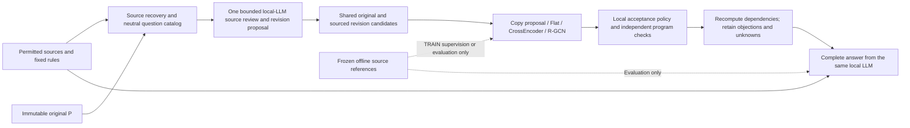

# From Source Verification to Complete Legal Answers: Mechanism Review and Implementation Design

2026-10-11, America/Phoenix. **Research proposal, not implemented or run at this checkpoint.** V19_8 remained the completed experiment. This document does not lift generation/training pauses or grant API/web budgets. Its historical comparator proposals do not authorize changes to the current plain-LLM baseline.

The review inspected the V19_8 entry and V14–V16 results, and surveyed attribution, evidence verification, self-correction, legal inference, evidence graphs and process evaluation. Retain program checks and add one bounded semantic step that reviews permitted sources and proposes local corrections. Replace the ambiguous target “is this evidence usable?” with “does the source support this explicit object, attribution or premise-support claim?” Literature motivates testing, not proven benefit for this project's 9B configuration.

The [main proposal](../../docs/SOURCE_GROUNDED_VERIFICATION_PLAN.md) states motivation, insight, potential contribution and deliverables. This report supplies comparisons, interfaces, budgets and evaluation contracts.

## 1. Questions and existing evidence

How can we verify source meaning beyond addresses/types? What semantic work requires a learned model rather than a simple program? How can local corrections improve complete answers without removing difficult content?

The task remains historical judgment-reasoning reconstruction. Records can establish what a court accepted/rejected; reconstruction does not independently validate that interpretation or predict an undecided case. Units remain dispute/stage, fixed request, object and dependency chain. Multiple links in a case are not independent cases.

| Observation | Supports | Does not support |
|---|---|---|
| V19_8 passed47 related checks, restored8 unresolved routes, left two cases' premise states unchanged | Specific interface blocks/omissions repaired | Defect-free code or reliable legal analysis |
| District Judge bound as tenant; two LEGAL_CONCEPT roles swapped; valid addresses cited for wrong purposes | Natural source/role/direction errors | All errors caused by model capacity |
| Learning input restores P citations and fixed neighboring units, not full-text omission detection | This input cannot reliably discover all decisive uncited content | Material on disk equals material read by the model |
| V15 restored two bounded paths; V16's six new roots are OPEN_TEXT | Reusable source alignment; use labels cannot replace open legal assessment | Relabeling/retraining alone completes all inference |
| Similar natural errors occurred on Together and locally | Mac hardware is not the main sufficient explanation | FP8 service and local4bit are a strict same-implementation control |

P jointly generates source interpretations, bindings, uses and whole-premise judgments; failures occur at semantic links, while checks enforce mechanical contracts. Context/task load may contribute, but no causal experiment separates these hypotheses. Decoding and quantization remain possible factors; do not change them simultaneously in a mechanism comparison. [V19_8 report](../proof-pipeline-diagnostic-repair-v19-8/report-zh.md).

## 2. Literature: support and limitations

The targeted search covered attribution/revision, evidence against self-correction, legal/graph inference, and local/whole-answer evaluation. Seventeen primary studies were registered, with publication pages/abstracts and selected key methods/limits read. Mostly2018–2025 work, not an exhaustive survey or blog-derived effect estimate. None directly evaluates this Qwen3.5-9B, corpus and rules; project transfer is a design inference.

### 2.1 Source verification versus generic self-correction

[RARR](https://aclanthology.org/2023.acl-long.910/) searches external evidence; factored [Chain-of-Verification](https://aclanthology.org/2024.findings-acl.212/) isolates verification answers from drafts but mainly uses internal knowledge. Borrow evidence reinspection/input isolation, not a claim that a fresh conversation is semantically independent.

[Huang et al.](https://arxiv.org/abs/2310.01798) identify extra information, computation and correctness feedback as confounds in self-correction. [ProCo](https://aclanthology.org/2024.emnlp-main.714/) supports conditional verification in a different setting, chiefly short/entity/numeric answers. These are not a simple contradiction, nor a guarantee of correct court-stage attribution in long judgments.

Give the verifier the same allowed sources and explicit claims, with no DEV references or corrected links from the main session. The historical design retains direct and self-review comparisons. RARR notes that factual edits need not repair downstream reasoning; recompute dependencies instead of merely polishing P.

### 2.2 Relevance, support and legal sufficiency differ

[AIS](https://aclanthology.org/2023.cl-4.2/) first resolves contextual/time interpretation, then source support. [ContractNLI](https://aclanthology.org/2021.findings-emnlp.164/) separates entailment/contradiction/not-mentioned from evidence spans. [FEVER](https://aclanthology.org/N18-1074/) evaluates claims and evidence sets. A valid address or related sentence is insufficient.

“A party raised an objection” differs from “the objection is legally valid”; allowing proceedings differs from finding substantive entitlement. Correct adverse evidence is not invalid because it opposes the claim. For OPEN_TEXT, source review may establish that a court adopted an assessment at a stage, not that a program independently derived its legal validity.

### 2.3 Graphs may integrate evidence without certifying semantics

[GEAR](https://aclanthology.org/P19-1085/) and [DocInfer](https://aclanthology.org/2022.emnlp-main.51/) support testing cross-evidence information, with different tasks/architectures. [Process-reward research](https://aclanthology.org/2025.findings-acl.547/) also warns of outcome shortcuts.

Test whether common objects, arrangements, support/opposition and dependencies help verify claims. Label edge provenance as source structure, explicit program relation or model proposal; never derive correct edges from references. CrossEncoder needs the same evidence/relations. Do not import GEAR's full connectivity, DocInfer's RL selection or mathematical PRMs wholesale as an unnecessary architecture.

### 2.4 Avoid abstention, brevity and label-copying shortcuts

[FActScore](https://aclanthology.org/2023.emnlp-main.741/) and [SAFE](https://arxiv.org/abs/2403.18802) motivate fine-grained source checks, not legal gold. SAFE's length proxy is not verified legal-content coverage. [ALCE](https://aclanthology.org/2023.emnlp-main.398/) distinguishes answer/citation quality; [FACTS Grounding](https://arxiv.org/abs/2501.03200) checks task fulfillment. Evaluate substance, objections and completion, not citation counts.

[ProcessBench](https://aclanthology.org/2025.acl-long.50/) values preserving correct reasoning as well as finding errors. [NLI shortcut research](https://aclanthology.org/P19-1084/) motivates copy-P/prior controls and actual-input checks. [Lost in the Middle](https://aclanthology.org/2024.tacl-1.9/) shows accessible context may be unused, but does not diagnose all project failures.

## 3. Mechanism: verify explicit claims and retain sourced revision candidates

Research hypothesis: with identical sources/local model, source verification plus bounded correction can reduce substantive final-answer errors while retaining valid analysis; learned verifiers may add value on the same candidates.

Separate structural checks, model-dependent conditional analysis, and completed independent source-review evaluation. Legal approval is separate. Model judgments cannot grant themselves formal approval.

### 3.1 Unit and labels

The unit is an explicit addressable semantic claim and its evidence set, reusing links, records, uses, fixed components and whole-premise addresses. Each has understandable objects, proposition, stage and scope. Do not fragment judgments into contextless word labels.

| Claim type | Question | Existing fields |
|---|---|---|
| Object/role binding | Do sources identify this rule role or shared arrangement? | object_links, role_bindings |
| Attribution | Who said, adopted, rejected or reported this, in which court/stage? | records proposition/status/court_level/stage; explicit speaker/adoption pointer if needed |
| Evidence use/premise support | Does the set support the stated supporting/opposing/background/whole-premise role, with qualifiers? | uses, components, judgment, dependencies |

Use one three-class task and type-specific reporting so easy citation items do not drown out critical binding errors. Programs handle addresses, hashes, IDs and completeness counts.

SUPPORTED means the exact scoped claim is source-supported. UNSUPPORTED means a definite source/object/attribution/direction/scope error. UNRESOLVED means insufficient common input, ambiguity or supported interpretive disagreement. Absence of support is not automatically UNSUPPORTED; technical failure is null. Supporting “this evidence opposes p” does not set p TRUE. A source may support the weaker “plaintiff alleges payment” without supporting “payment occurred.” Preserve both scopes and originals; background is not automatically a premise.

### 3.2 Complete flow

First, prepare a neutral catalog from the fixed request, rule roles and required components, such as the tenant's identity or court/stage of an objection. Do not derive it from known errors or references. Show copyable source IDs; models do not compute offsets, copy long quotations or generate hashes.

Second, perform one bounded review over full permitted sources, rules, catalog and P claims. Hide P self-labels/confidence/self-justification while retaining content needed to understand the claim. Freeze field-level removal before generation; no keyword filtering that deletes negation or genuine interpretation. Inspect catalog topics omitted by P, not only P's windows. Supply full sources when possible without external RAG. Split long material by continuous source position and registered rules, preserving scope/request and cross-package dependencies. Mark over-limit content unprocessed; failure to find is not source absence. “Read source before comparing P” is an instruction, not an enforced internal reasoning order. Same-model errors may correlate; hiding labels reduces one bias but does not ensure independence. No multi-agent voting, reflection loops or per-field calls.

Third, retain original judgments and sourced alternative bindings, attributions, witnesses or missing components with explicit revised-address pointers. Never overwrite P or guess-correct source/EV IDs. New witnesses and repaired citations are distinct records. Rejecting “judge is tenant” does not create the correct tenant; it must already exist in P or sourced common candidates. Otherwise preserve the gap. Measure candidate omission separately from verification failure.

Fourth, D copies the review proposal; E/F/G use Flat/CrossEncoder/R-GCN over identical candidates, sources, rules, dependencies, opposing claims and display contract. Learned models cannot invent facts/rules. Features include claim text, sources and necessary explanations, but exclude self-labels, references, review decisions and downstream outcomes.

Fifth, apply predictions locally and recompute. Supported claims remain machine-accepted conditional assumptions. Rejected uses do not erase sources, other valid uses, counterarguments or independent OR branches. Incompatible supported candidates become conflict; votes or arbitrary scores cannot merge identities. Unlinked roles remain unmapped. Programs recompute only approved explicit ALL/ANY/exception structures. Whole premises still require complete judgments/evidence; several supported uses do not imply TRUE. A court's open assessment can enter reconstruction as an attributed external semantic record; OPEN_TEXT remains outside program proof.

Finally, the same LLM reads complete case material, rules and each method's canonical view. Programs check citations/traces, not legal truth of prose. New unsupported claims, trace misuse and omitted objections count as final-stage errors. No semantic retry or post-scoring rewrite.

## 4. Minimal implementation and capacity

Integrate after complete conversion/merge checks and before evidence acceptance/premise combination in [_process_saved](../../scripts/proof_pipeline_contract_v19_8.py). Version/hash original P, canonical P, proposals, predictions, applied view and answer separately.

| Component | Reuse | Required addition |
|---|---|---|
| Sources | Document identity, addresses, recovery, strict citations, local isolation | Full review-scope manifest beyond P windows |
| Candidates | V15/V16 supplements/local acceptance; V19 roles/components | Current review package, revision mapping, semantic decisions |
| Learning | Flat, CrossEncoder, R-GCN, fixed encoder | Same evidence/relations, label removal, new input hashes |
| Computation | V19_8 local grounds, shared variables, unresolved identity, alternatives | Scoped application and dependency recomputation |
| Checker | Conversion/merge fidelity, evidence preservation, traces | Review-record/scope checks, not independent language validation |
| Final answer | Saving/pausing/null semantics/full materials | One canonical analysis view without repeated raw/import/check logs |

Records lack a separate speaker field. Add a sourced speaker/adoption pointer only when proposition text cannot reliably encode attribution; court_level cannot substitute for the speaker/adopter. Reuse remaining fields rather than creating a universal ontology.

Use `proof_pipeline_contract_v19_8_1` and its repaired capacity function, not the retained old entry. Case1187427's D input is56,986 tokens; with8,192 output plus256 margin only102 remain. Do not append the full verification log.

Each method should display full sources once, rules once, necessary accepted/disputed claims once, and objections/gaps once. Preserve raw P, checks and revision history for audit, but identify exactly what the final prompt contains. Deduplicating engineering metadata differs from deleting legal content; adverse predictions must not remove sources, qualifiers or objections.

CrossEncoder cannot silently truncate to512 tokens and claim identical evidence. Freeze deterministic windows/aggregation within its model limit; give Flat/GNN the same units/relations and disclose unsupported cross-window relations. Do not give only GNN full material. Freeze this necessary adaptation before training without a window/aggregation search.

The local verifier reads all allowed sources. Learned verifiers read deterministic claim packages: old citations, new witnesses, counterevidence and fixed context. All three share the package; no claim that each prediction encodes the full judgment. References requiring outside evidence are ineligible for this supervision; do not use labels to select extra passages. Distinguish source-review/candidate omission, assembly omission and errors despite encoded evidence.

## 5. Supervision and learning models

Reuse sources, P, rules, objects, reviews and dispute groups, but do not rename all old USABLE labels. V14's13 checked agreements do not validate the rest. Store claim address, evidence, scope and support label. Reuse only semantically identical old independent reviews whose evidence is visible; mark others incompatible/insufficient/pending rather than negative.

New references see sources and claims, not P/proposal self-labels or predictions. Clear opposition is not a reference dispute; dispute means a source-supported unresolved reviewer disagreement. Freeze complete-answer references from sources/request/rules before seeing DEV answers, covering facts, bindings, courts/stages, scope, objections, qualified conclusions and unknowns. TRAIN labels can train; DEV labels cannot influence candidates, links, acceptance or prompts. These remain source-reviewed model references, not human gold.

| Method | Implementation | Forbidden shortcut |
|---|---|---|
| Copy P/review proposal | Reuse judgments only where meanings align | Missing corresponding judgments forced negative |
| TRAIN prior | Global/type distributions with sufficient coverage and explicit fallback | DEV labels, case IDs or outcomes |
| Flat | Fixed-encoder same-source/claim/relation features with simple aggregation | Less information than GNN |
| CrossEncoder | Joint claim/source/binding/relation windows, fixed aggregation | P labels or incomplete truncated evidence |
| R-GCN | Small graph of claims, sources, objects and rule components | Reference-derived edges or graph propagation as approval |

Preserve citation, claimed-object, proposed support/opposition, component and explicit same-object candidate edges. Shared source IDs show shared text, not entity identity; candidate identity stays unverified. GNN predicts support of explicit claims, not judgments/new rules.

No new architecture, RL or second judge model. One fit each for Flat/CrossEncoder/R-GCN, seed20261001, using verified existing optimization settings. Early stopping uses a dispute-separated TRAIN-internal validation subset, without moving official TRAIN/DEV. Share supervision masks; unlabeled candidates still enter inference. Incompatible old weights need separately saved retraining, not renaming.

An offline source-removal/wrong-object sensitivity control can detect copying. It is synthetic diagnosis, not natural legal performance, new training data or threshold tuning. Separate natural errors, perturbations and duplicate candidates. Fixed argmax may classify; UNRESOLVED is semantic, not merely low confidence. No DEV-optimized rejection thresholds.

## 6. One complete comparison

Keep seven historical conditions; D–G change intermediates materially and require new version names, not V19 scores under an allegedly unchanged interface.

| Condition | Actual input/steps | Question |
|---|---|---|
| A | Same local LLM reads permitted sources/rules directly | Basic full-answer capability |
| B | Same LLM reviews A with the same material | Generic self-review benefit/cost |
| C | Same sources plus original P | Value of unverified structured proposals |
| D | Same sources plus one review proposal and shared program, copying its labels | Net value of source review/recomputation |
| E | D candidates/material, Flat labels | Increment over copying review |
| F | Same, CrossEncoder labels | Increment from textual interaction |
| G | Same, R-GCN labels | Increment from relational propagation |

D versus C includes an extra call and shared processing, not isolated field/graph effects. E/F/G reuse one cached proposal for learned-verifier comparison. A–D have different call costs; B is an extra-computation comparator, not exact D-budget matching. No equal-budget multi-sampling condition is proposed initially, so mechanism and computation contributions remain partly confounded; report quality/cost tradeoffs.

### 6.1 Samples and reuse

Use existing30 TRAIN and at most10 DEV, one predetermined request plus dependencies each. Do not move groups, read TEST/SEALED, add cases/authorities or replace failures. 1954254/1187427 are exposed deep-development regressions; primary-table inclusion follows existing splits. Two Together P records can support shared-interface replay. A claimed local-system batch requires the fixed local revision/quantization or compatible cache; FP8 service diagnosis stays separate. Retain semantic errors; only unreadable/incompatible tasks receive preregistered new-version generation.

Inventory reusable/missing P, review packages, label tasks and final-answer tasks once. Missing sources, failed citations and OPEN_TEXT are not reasons to replace cases. Disclose repeated DEV exposure; no independent-test claim.

### 6.2 Freeze and execution gates

Perform one complete existing-cache acceptance covering addresses, revisions, features, application, dependencies, checker, final inputs, pause/failure persistence. Preserve valid links and reject invalid ones; no per-field model trials. Freeze samples, sources/rules, P producer, contracts, label removal, merge policy, models, supervision, budgets and scoring. Later generated TRAIN labels freeze before training; answer checklists freeze before DEV answers. Hash dynamic contents under predetermined assembly rules without pretending they existed at initial freeze.

Insufficient supervision, leakage, unusable input or resources block dependent work. High P performance, likely GNN failure or OPEN_TEXT remaining unknown are not cancellation grounds. Absence of natural correction opportunities is a result; synthetic faults cannot manufacture natural headroom.

### 6.3 Proposed resources, not authorization

| Item | Proposed ceiling |
|---|---|
| New P | Necessary incompatible/missing items within original87 packages; no rerun of compatible completed items |
| Source review | Up to40 existing requests×2 preregistered packages=80 calls; not per field |
| Final answers | Up to10 DEV×7=70; dependent unstarted failures explicitly skipped |
| Local generation | Worst-case237 calls; actual P gaps+review+answers, reduced by compatible cache |
| Generation time |36h total,12h each for P/review/final;60min per call; feasibility unproven |
| Training | One fixed-seed fit per model; proposed24h total, inventory first, no search |
| Web references/scoring | Up to70 Extra High:40 claim reviews,10 answer checklists,20 blinded scores; reuse compatible references; source/old-reply adjudication before any extra request |
| Semantic retries/extensions |0 retries, continuation, replacement cases, extra seeds, external RAG or new weights |

These planning ceilings do not expand the old157-call authorization. Keep local Qwen3.5-9B revision, quantization, framework, thinking and sampling fixed. The65,536 total context,16,384 P/review output and8,192 final output are proposed operating budgets subject to real token-array checks, not natural model limits. Do not retune from vendor advice mid-run.

Requests exceeding two review packages, required-material capacity or scoring-package bounds become preregistered failures/partial coverage, not silent truncation. If preparation shows infeasibility, revise the resource proposal before generation rather than borrowing later-stage reserves.

## 7. Whole-answer evaluation

Trace every natural change: P claim→proposed correction→verifier label→applied record→dependency change→substantive final statement. Without traceability report co-occurrence, not causal benefit. Retaining an important objection may help even when labels do not change, but whole-analysis gains still need final evaluation.

| Layer | Report | Boundary |
|---|---|---|
| Evidence discovery | Confirmed key witnesses in candidates/encoded inputs; omitted objections | Incomplete references do not support exhaustive recall |
| Local verification | Three-class confusion, precision/recall/Macro-F1, false admission/blocking, unresolved states | Separate binding, attribution, use/full coverage; include copy-P/Q and priors |
| Dependencies/revisions | Correct repairs, damaged correct judgments, preserved/blocked paths, OPEN_TEXT boundaries | Separate synthetic/natural; program acceptance is not legal proof |
| Complete answers | Confirmed important-content coverage, unsupported claims, disputes with serious errors, task completion | Not citation count, length, fewer UNKNOWNs or outcome-label agreement |
| Resources/completion | All planned tasks, calls/tokens/time/training/review | Technical null separate; paired common-completion results also reported |

Freeze key items before answers. Score substantive claims by object+relation/effect+stage/scope; synonyms count once. Newly stated unlisted claims still require source review, not automatic rejection. An empty answer has undefined unsupported-claim rate, not zero error. Explicit source conflict, wrong binding, stage escalation, scope or necessary-condition errors can be serious; genuine interpretive disputes remain separate.

Hide method names/intermediate predictions and order answers with seed20261001. Reviewers receive sources, frozen checklist and neutral IDs, not explanations that GNN repaired something. Style may compromise blinding. Web references and main-session source adjudication remain model-assisted, not human legal approval; runtime acceptance labels cannot grade final answers.

Aggregate first by request, then equally by dispute. Small DEV does not justify two-case rankings or treating hundreds of edges as hundreds of cases. Report paired differences, concrete serious errors and costs. If references change, preserve prior versions and rescore all affected methods without feeding changes back into this run.

## 8. Implementation and delivery sequence

Implement shared source/role/component adapters, review packages, versioned revisions, same-information features, local acceptance and canonical final view; use the two existing cases for whole-entry replay rather than generating after each field change. Freeze existing groups/exposure, compatibility inventory, tasks, resources and scoring after engineering acceptance.

Then, subject to separate authorization, fill only necessary P gaps, review the batch, create/reuse compatible supervision, freeze TRAIN labels/DEV checklists, fit the three models once, and generate A–G in a balanced fixed order. Failures block only dependents. Finally review decisive changes against sources and deliver error propagation, retained information and costs, with source/input/model/output hashes, raw replies, predictions, dependencies, revisions, answers, scores and failures. Prepare/inspect/verify does not authorize pushing or another round.

A systematic engineering error pauses affected steps and requires a new version; never mix pre/post-fix scores. Natural misreading, interpretive disagreement and no benefit remain results. Each task has start/completion/failure receipts. Unknown submission status must not trigger resubmission; after a safe pause resume only unstarted tasks.

## 9. Decision rules and unresolved risks

Keep source review only if important errors are corrected without comparably serious loss of valid grounds/objections. Fewer SUPPORTED labels alone are insufficient. If D helps but E/F/G add nothing, retain D and stop expanding learning. Prefer cheaper Flat/CrossEncoder if they match GNN; expand graphs only for same-information cross-evidence and whole-answer gains.

If proposals are wrong or correct alternatives absent, identify semantic/candidate bottlenecks rather than asking classifiers to invent them. If local repair helps but final prose reintroduces errors, diagnose final expression/use instead of tuning local F1. If A is equal/better, permit returning to A.

Limits: correlated same-model errors, repeatedly exposed DEV, shared model-reference bias, and unequal local4bit/FP8 implementations. Canonical views reduce repetition but their actual use still needs final-answer evaluation; round-trip engineering fidelity is insufficient. The proposed chain verifies explicit scoped claims using all permitted sources, learns support on shared candidates and measures final effects while retaining valid analysis. Two manually successful paths or component counts are not completion.

## 10. Evidence index

Seventeen studies and reading scope: [literature.json](literature.json). Source/code hashes, scope and original nonexecution statement: [design-record.json](design-record.json), retained as the original dated record; translated documentation has new hashes.

- [V19_8](../proof-pipeline-diagnostic-repair-v19-8/report-zh.md), [V15](../proof-source-alignment-v15/report-zh.md), [V16](../proof-source-alignment-v16/report-zh.md).
- [Shared entry](../../scripts/proof_pipeline_contract_v19_8.py), [computation](../../legal_bench/proof_carrying/local_pipeline_v19_8.py), [checker](../../legal_bench/proof_carrying/local_checker_v19_8.py).
- [Repaired final entry](../../scripts/proof_pipeline_contract_v19_8_1.py), [assembly](../../legal_bench/proof_carrying/final_delivery_v19_8_1.py), [capacity](../../legal_bench/proof_carrying/capacity_v19_8_1.py).

At the original checkpoint this work comprised research, read-only code inspection and design documentation: zero new generation, annotation, training or executor edits, no TEST/SEALED access or push. Translation does not change that historical status.
